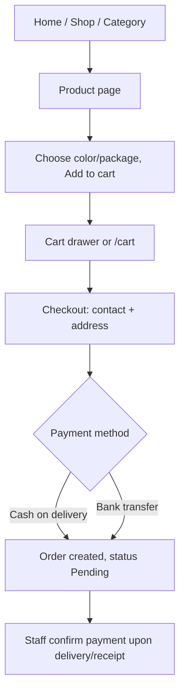
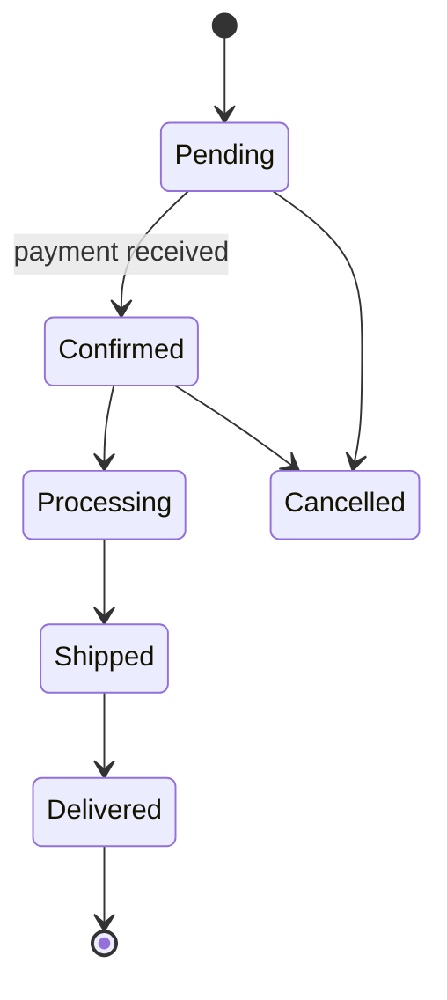

# Actor Workflows

Overview of every actor in the Hellobee® storefront (`https://www.hellobee.org`) and the flows each one takes part in.
Sources: `src/app/**` (routes), `backend/routes/api.php` (API and role guards), `backend/app/Services/*`
(order lifecycle, payments, commissions), `docs/EMPLOYEE_BENEFITS.md` (compensation plan).

## 1. Actors

| Actor | How they sign in | Where they work | Can do |
| --- | --- | --- | --- |
| Guest | not signed in | storefront | browse, search, cart, wishlist, check out as a guest, register, reset password |
| Customer | email + password (role `customer`) | storefront, `/account`, `/orders` | everything a guest can, plus saved profile and addresses, order history, reviews, saved sponsor code |
| Employee (consultant) | email + password (role `employee`) | `/employee` | referral link and code, consultation queue, order fulfillment, stock lookup, commissions, payout requests |
| Admin | email + password (role `admin`) | `/admin/*`, also `/employee` | everything an employee does, plus catalog, customers, discounts, events, reviews, inventory, network, settings, refunds, mark-paid, payouts |
| Scheduler | cron in `scheduler` service | backend | releases stock held by stale unpaid orders |

Access control: `/admin` and `/employee` redirect to sign-in when there is no session. Portal navigation shortcuts in the storefront header are visible only to signed-in `employee` and `admin` users. API routes under `v1/admin` require role `admin` or `employee`; most of them (products, customers, refunds, settings, audit logs) are `admin` only. Employees can list orders and change order status.

## 2. Route map

| Area | Routes |
| --- | --- |
| Public | `/`, `/shop`, `/category/[slug]`, `/product/[slug]`, `/events`, `/hellobee`, `/cart`, `/wishlist`, `/checkout`, `/order-success` |
| Account | `/login`, `/register`, `/forgot-password`, `/reset-password`, `/account`, `/orders` |
| Employee | `/employee` (tabs: Order Fulfillment, Consultation Queue, Warehouse Stock Lookup, Referral Link and QR, Employee Benefits) |
| Admin | `/admin` (dashboard), `/admin/products`, `categories`, `orders`, `customers`, `discounts`, `events`, `hellobee`, `inventory`, `reviews`, `settings` |

## 3. Guest and customer flows

### 3.1 Browse and buy

1. The customer picks a product and a configuration (color or package) and adds it to the cart.
2. At checkout they enter name, US phone, email, and shipping/installation address (including ZIP/postal code), and may apply a promo code and a referral code. Totals come from the backend quote (`POST checkout/quote`), never from the browser.
3. They choose **Cash on Delivery (COD)** or **Hellobee Corporate Bank Wire Transfer** (`GET checkout/config` lists active payment methods; Stripe is disabled by default unless `STRIPE_ENABLED=true`).
4. The order becomes `Paid` through `OrderService::markPaid` when an admin confirms payment. That is also the only place commissions are created.
5. Guests receive an access token so they can view the order without an account.

### 3.2 Account

| Task | Route | Notes |
| --- | --- | --- |
| Register | `/register` | password requires 8+ characters; optional sponsor code (for example `HBEE03`) is saved permanently |
| Sign in / out | `/login` | role-based redirect to `/account`, `/employee`, or `/admin` |
| Reset password | `/forgot-password` then `/reset-password` | email link built from `STOREFRONT_URL` (also accessible from `/account`) |
| Profile, addresses | `/account` | name & US phone editing, multiple shipping addresses with default toggle, assigned specialist display |
| Orders | `/orders`, `/account` | full order ID, discount breakdown, ZIP code, and status history timeline |
| Wishlist | `/wishlist` | heart icon on product cards (starts empty for new visitors) |
| Review a product | product page | goes to the admin moderation queue |

### 3.3 Order lifecycle

Payment status runs separately: `Unpaid` to `Paid` to `Refunded` (refund is admin only and only for paid orders).
A cancelled order cannot be reopened.

## 4. Employee (consultant) flows

1. Registered customers with the employee's sponsor code appear in the Consultation Queue with contact details.
2. The employee shares a referral link or QR code from the Referral tab.
3. When a referred customer's order is marked `Paid`, the backend credits commission:
   - 10% direct commission to the sponsor.
   - 1% override to each qualifying upline, up to 5 levels above.
4. The Employee Benefits tab shows personal sales volume, lifetime commission, available balance, team size, and progress through the `LV1` to `LV10` ladder, as defined in `docs/EMPLOYEE_BENEFITS.md`.
5. The employee requests a payout from the available balance; an admin approves or rejects it (`PATCH hellobee/payouts/{payout}`).
6. Order Fulfillment lets the employee move referral orders through `Confirmed`, `Processing`, `Shipped`, and `Delivered`.

If a customer checks out without typing a referral code, the saved sponsor code from registration is applied automatically so the commission is still awarded.

## 5. Admin flows

| Section | What the admin does |
| --- | --- |
| Dashboard | revenue, orders, active products, customers, revenue trend |
| Products, Categories | create, edit, delete; every change refreshes the storefront cache |
| Orders | list, change status, refund, mark paid for cash on delivery or bank transfer |
| Customers | list, create, edit accounts |
| Discounts | create and edit promo codes such as `WELCOME10` or `FREESHIP` |
| Events | publish and delete member events |
| Hellobee Network | view members and ranks, approve or reject payout requests |
| Inventory | view stock, adjust quantities (recorded in the audit log) |
| Reviews | approve, edit, or delete submitted reviews |
| Settings | store name, description, and contact details |
| Audit log | read-only history of admin actions |

## 6. End to end example

1. A prospect meets employee David (`HBEE03`) and registers on `/register` with that code.
2. The prospect appears in David's Consultation Queue; David calls them.
3. The customer orders an emGuarde ($1,500) via COD or Bank Wire Transfer.
4. Once payment is confirmed (`Paid`), stock is committed, David earns $150 (10%), and qualifying uplines earn 1% ($15) each.
5. An admin or David moves the order to `Shipped` and `Delivered`; the customer sees each step in `/orders`.
6. David requests a payout; an admin approves it.
